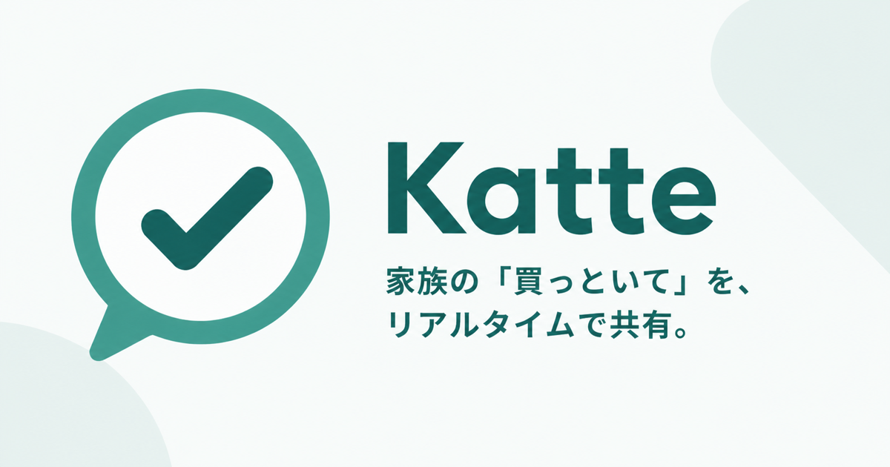

# Katte



家族や同居人と「買ってきてほしいもの」をリアルタイム共有するFlutterアプリです。

ブランドアイコンは、家族から届く依頼を表す「吹き出し」と、購入完了を表す
「チェック」を組み合わせています。Brand Colorは `#3B9C8F` です。

プロダクト仕様と開発方針は [docs/README.md](docs/README.md) を参照してください。

## 開発

```bash
flutter pub get
flutter analyze
flutter test
flutter run
```

iOSでの実行にはXcode、Androidでの実行にはAndroid StudioとAndroid SDKが必要です。
